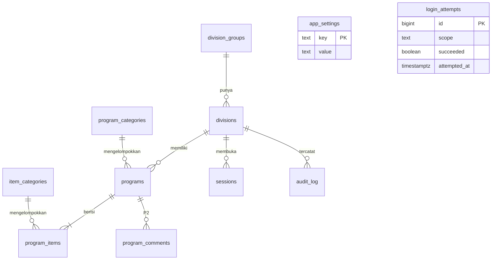

# 04 - ERD & Skema Database

Database: PostgreSQL (Supabase). Diagram di bawah memakai sintaks Mermaid; jika tidak ter-render, gunakan tabel dan DDL di bagian 2 dan 3 (isinya sama).

## 1. Diagram



Relasi dalam kata:
- `division_groups` 1-N `divisions`
- `divisions` 1-N `programs`
- `programs` 1-N `program_items` (hapus program -> baris ikut terhapus)
- `program_categories` 1-N `programs`; `item_categories` 1-N `program_items`
- `sessions`, `audit_log`, `login_attempts`, `app_settings` adalah tabel pendukung.

## 2. Tabel dan kolom

| Tabel | Fungsi |
|---|---|
| app_settings | Pengaturan: tahun anggaran, hash master PIN, kontak Finance |
| division_groups | Grup divisi (Human Resource, Marketing, ...) |
| divisions | 12 divisi + hash PIN |
| program_categories | Kategori besar program (Event, Training, ...) |
| item_categories | Kategori baris kebutuhan (Jasa, Konsumsi, ...) |
| programs | Header pengajuan (1 program = 1 bulan) |
| program_items | Baris kebutuhan |
| sessions | Token sesi (hanya hash) |
| login_attempts | Percobaan login untuk lockout |
| audit_log | Riwayat perubahan dengan snapshot JSON |
| program_comments | (P2) komentar Finance |

## 3. DDL (acuan; boleh disempurnakan, jangan mengubah maksud)

```sql
-- Ekstensi (di Supabase berada di schema "extensions"; atur search_path fungsi)
create extension if not exists pgcrypto;
create extension if not exists pg_trgm;

create table app_settings (
  key        text primary key,
  value      text not null,
  updated_at timestamptz not null default now()
);
-- key yang dipakai: tahun_anggaran ('2027'), finance_pin_hash, contact_email_1,
-- contact_email_2, contact_wa

create table division_groups (
  id         smallint generated always as identity primary key,
  name       text not null unique,
  sort_order smallint not null default 0
);

create table divisions (
  id             smallint generated always as identity primary key,
  group_id       smallint not null references division_groups(id),
  code           text not null unique,          -- slug untuk URL, contoh 'hr-pd'
  name           text not null,
  pin_hash       text,                          -- bcrypt via crypt(); null = belum diset
  pin_updated_at timestamptz,
  is_active      boolean not null default true,
  sort_order     smallint not null default 0
);

create table program_categories (
  id         smallint generated always as identity primary key,
  name       text not null unique,
  is_active  boolean not null default true,
  sort_order smallint not null default 0
);

create table item_categories (
  id         smallint generated always as identity primary key,
  name       text not null unique,
  is_active  boolean not null default true,
  sort_order smallint not null default 0
);

create table programs (
  id                  uuid primary key default gen_random_uuid(),
  division_id         smallint not null references divisions(id),
  nama_program        text not null check (char_length(btrim(nama_program)) between 3 and 150),
  program_category_id smallint not null references program_categories(id),
  periode_bulan       smallint not null check (periode_bulan between 1 and 12),
  pic_nama            text not null check (char_length(btrim(pic_nama)) between 2 and 100),
  status              text not null default 'draft' check (status in ('draft','diajukan')),
  tanggal_pengajuan   date,                      -- diisi server saat submit pertama (WIB)
  submitted_at        timestamptz,
  created_at          timestamptz not null default now(),
  updated_at          timestamptz not null default now(),
  created_by_name     text,
  updated_by_name     text,
  check ((status = 'diajukan') = (tanggal_pengajuan is not null))
);

create table program_items (
  id               uuid primary key default gen_random_uuid(),
  program_id       uuid not null references programs(id) on delete cascade,
  urutan           smallint not null,
  uraian           text not null check (char_length(btrim(uraian)) between 3 and 200),
  item_category_id smallint references item_categories(id),     -- boleh null saat draft; wajib saat submit
  qty              numeric(12,2) check (qty is null or qty > 0),
  satuan           text check (satuan is null or char_length(btrim(satuan)) between 1 and 30),
  harga_satuan     bigint check (harga_satuan is null or (harga_satuan >= 0 and harga_satuan <= 1000000000000)),
  catatan          text check (catatan is null or char_length(catatan) <= 300),
  subtotal         bigint generated always as (coalesce(round(qty * harga_satuan), 0)::bigint) stored
);

create table sessions (
  token_hash   text primary key,                 -- sha256 hex dari token
  role         text not null check (role in ('division','finance')),
  division_id  smallint references divisions(id),
  actor_name   text,
  created_at   timestamptz not null default now(),
  expires_at   timestamptz not null,
  last_seen_at timestamptz not null default now(),
  check ((role = 'division') = (division_id is not null))
);

create table login_attempts (
  id           bigint generated always as identity primary key,
  scope        text not null,                    -- kode divisi atau 'finance'
  succeeded    boolean not null,
  attempted_at timestamptz not null default now()
);

create table audit_log (
  id          bigint generated always as identity primary key,
  occurred_at timestamptz not null default now(),
  actor_role  text not null,                     -- division | finance | system
  division_id smallint references divisions(id),
  actor_name  text,
  action      text not null,                     -- create, update, submit, delete, pin_reset, master_pin_change,
                                                 -- category_change, lockout, unlock, export
  entity_type text not null,                     -- program, division, category, session, export
  entity_id   text,
  old_data    jsonb,
  new_data    jsonb,
  reason      text
);

create table program_comments (                  -- P2, boleh dibuat nanti
  id          uuid primary key default gen_random_uuid(),
  program_id  uuid not null references programs(id) on delete cascade,
  author_role text not null,
  author_name text,
  body        text not null check (char_length(body) between 1 and 1000),
  created_at  timestamptz not null default now()
);

-- Indeks
create index on programs (division_id, periode_bulan);
create index on programs (status);
create index programs_nama_trgm on programs using gin (nama_program gin_trgm_ops);
create index on program_items (program_id);
create index on audit_log (occurred_at desc);
create index on audit_log (division_id);
create index on login_attempts (scope, attempted_at desc);
create index on sessions (expires_at);

-- Keamanan: RLS aktif di SEMUA tabel, tanpa policy, hak dicabut
alter table app_settings       enable row level security;
alter table division_groups    enable row level security;
alter table divisions          enable row level security;
alter table program_categories enable row level security;
alter table item_categories    enable row level security;
alter table programs           enable row level security;
alter table program_items      enable row level security;
alter table sessions           enable row level security;
alter table login_attempts     enable row level security;
alter table audit_log          enable row level security;
alter table program_comments   enable row level security;

revoke all on all tables    in schema public from anon, authenticated;
revoke all on all sequences in schema public from anon, authenticated;
-- Fungsi RPC diberi EXECUTE hanya untuk yang diperlukan (lihat 01_BLUEPRINT bagian 6).
```

## 4. Aturan integritas tambahan (diimplementasi di fungsi/ trigger)
- `updated_at` otomatis diperbarui saat program atau item berubah.
- `tanggal_pengajuan` = `(now() at time zone 'Asia/Jakarta')::date` saat submit pertama; tidak berubah lagi.
- Submit memvalidasi: minimal 1 baris; tiap baris punya uraian, kategori aktif, qty > 0, satuan, harga >= 0.
- Kategori yang dipilih harus `is_active = true` saat dipakai; kategori nonaktif tetap tampil pada data lama.
- Hapus program: log `audit_log` berisi snapshot `old_data` (header + array items) **dalam transaksi yang sama**.
- Pembersihan berkala: hapus `sessions` kedaluwarsa dan `login_attempts` > 30 hari (opsional, dalam `rpc_ping` atau fungsi pemeliharaan).
- Sesi dan percobaan login tidak boleh bisa dibaca dari browser.

## 5. Query rekonsiliasi (acuan untuk tes O-xx)
```sql
-- Total diajukan per divisi
select d.name, count(*) as jml_program, sum(t.total) as total
from programs p
join divisions d on d.id = p.division_id
join (select program_id, sum(subtotal) as total from program_items group by program_id) t on t.program_id = p.id
where p.status = 'diajukan'
group by d.name order by d.name;

-- Total per bulan
select p.periode_bulan, count(distinct p.id), sum(i.subtotal)
from programs p join program_items i on i.program_id = p.id
where p.status = 'diajukan' group by 1 order by 1;

-- Total per kuartal
select ((p.periode_bulan - 1) / 3) + 1 as kuartal, sum(i.subtotal)
from programs p join program_items i on i.program_id = p.id
where p.status = 'diajukan' group by 1 order by 1;
```
